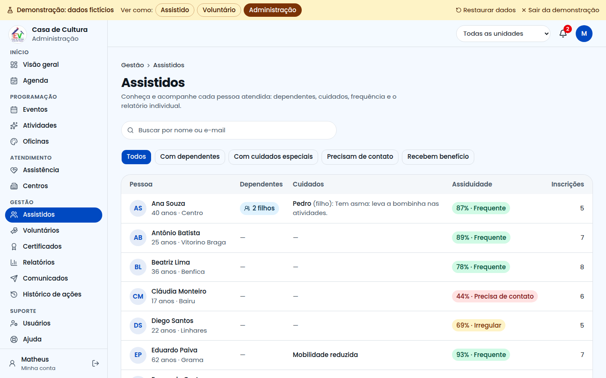
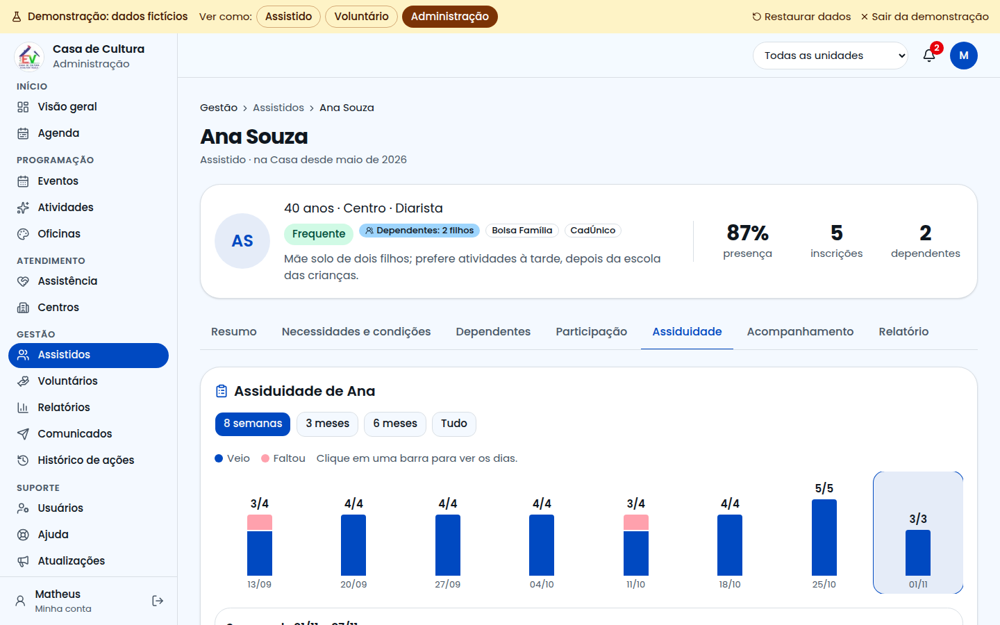
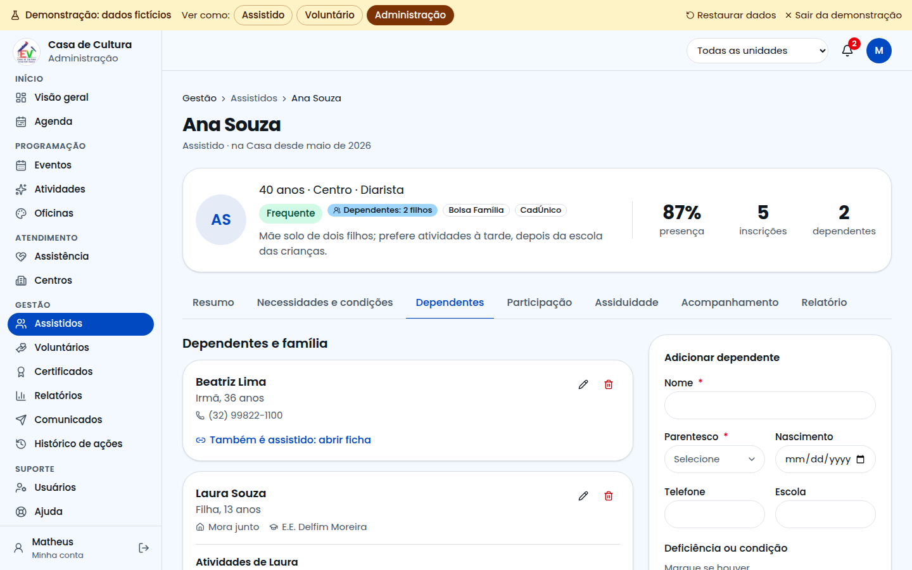
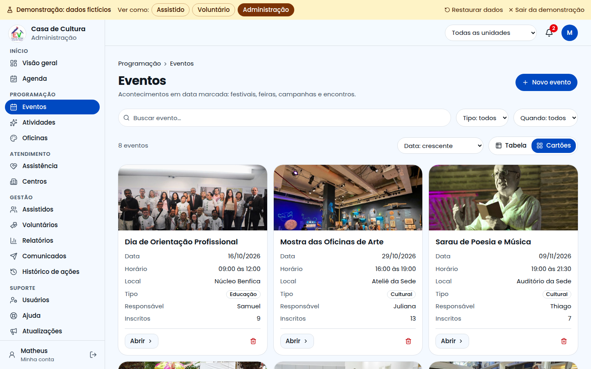
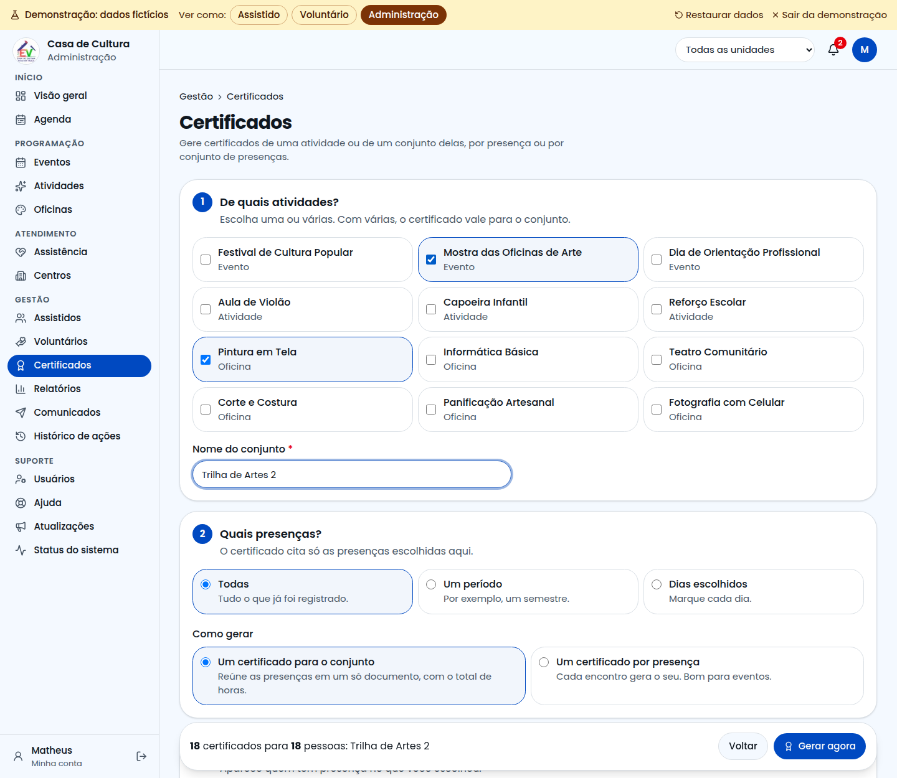

# Guia da Administração

Este guia é para a coordenação e a equipe administrativa. Aqui você cadastra a programação, conhece e acompanha as pessoas, e presta contas dos resultados.

## Como entrar

A entrada da administração **não aparece na página inicial**. Acesse o endereço do sistema com **/administracao** no final e entre com seu e-mail e senha.

## Visão geral

É a tela do dia a dia, nesta ordem:

1. os números principais;
2. a agenda da semana;
3. o quadro com eventos, atividades, oficinas e assistência;
4. **Precisa de atenção**, com pendências como pessoas que faltaram muito, pedidos sem resposta e itens sem responsável.

## Agenda

Mostra tudo o que acontece, em três formatos: **Mês**, **Semana** e **Lista**. No mês, clique em um dia para ver os compromissos dele logo abaixo do calendário. O botão **Baixar para o calendário** gera um arquivo para o celular.

No alto, veja quantos encontros há hoje, na semana e no mês, e quantos itens estão sem responsável. Filtre por responsável. Cada compromisso do dia mostra quem conduz, quantos inscritos tem e o botão **Chamada**.

## Qual cadastro usar

| Use | Quando | Exemplo |
|---|---|---|
| **Evento** | Acontece em uma data | Festival de Cultura Popular |
| **Atividade** | Se repete, ou acontece uma vez | Aula de Violão |
| **Oficina** | Turma com vagas limitadas | Pintura em Tela |
| **Assistência** | Serviço de apoio | Orientação Jurídica |
| **Centro** | Local onde o projeto atua | Núcleo Benfica |

## Como cadastrar

1. No menu, escolha o tipo.
2. Clique em **Novo** (ou **Nova**).
3. Preencha os campos com asterisco. **A foto é obrigatória**: ela aparece para quem vai se inscrever.
4. Responda se a atividade **emite certificado**.
5. Clique em **Criar**.

Se faltar algo, o campo fica vermelho e explica o que fazer.

## A página de cada item

Ao clicar em um item, você vê a foto, as próximas datas, as vagas, a lista de espera, o responsável e um **mapa com o endereço**.

Nessa página você pode abrir a **Chamada**, **Editar**, **Duplicar** (bom para repetir no próximo semestre) e **Excluir**. A página tem abas: **Visão geral**, **Inscritos** (tabela com idade, bairro, dependentes e cuidados), **Diário de presença** e **Certificados**.

## Assistidos: conhecer e cuidar de cada pessoa

Em **Gestão > Assistidos** está a lista de quem a Casa atende, com os dependentes, os cuidados e a assiduidade de cada um. Filtre por **com dependentes**, **com cuidados especiais**, **precisam de contato** ou **recebem benefício**.

Clique no nome para abrir a página da pessoa:

| Aba | O que tem |
|---|---|
| Resumo | Contato, assiduidade, último acompanhamento e dependentes |
| Necessidades e condições | Deficiência, acessibilidade, o que ajuda, o que evitar, saúde e condição social |
| Dependentes | Filhos e outros familiares, com os cuidados e as atividades de cada um |
| Participação | Cada atividade em detalhes, encontro por encontro. Dá para inscrever e tirar |
| Assiduidade | Barras clicáveis, a conta do número e o histórico completo |
| Acompanhamento | Linha do tempo de atendimentos, ligações, visitas e próximos passos |
| Relatório | Resumo para imprimir: o que vai bem e onde dá para ajudar |

### Assiduidade

Clique em uma barra para ver cada dia daquele período. Mude entre 8 semanas, 3 meses, 6 meses e tudo. A página mostra a conta: presenças divididas por encontros.

### Dependentes

Quando alguém tem filhos ou outros dependentes, cada um pode ser inscrito nas atividades. Ele entra na chamada, ocupa vaga e tem a própria assiduidade. Os cuidados dele ficam junto do cadastro.

Se a pessoa faltou 3 vezes seguidas, um aviso sugere entrar em contato.

> **Cuidado:** essas informações são sensíveis. Registre só o necessário, com o consentimento da pessoa ou do responsável. Os dados pessoais ficam escondidos até você clicar em **Mostrar dados**.

## Voluntários

Em **Gestão > Voluntários** você vê o que cada um conduz e quando pode ajudar. Na aba **Pedidos**, responda quem quer ser voluntário. A página de cada voluntário traz horários, atividades, inscritos e dados profissionais.

## Usuários

Em **Suporte > Usuários** ficam as contas de acesso: mude o papel de uma pessoa e envie convites.

## Tabela ou cartões

Em Eventos, Atividades, Oficinas, Assistência e Centros, escolha ver em **Tabela** ou **Cartões**, com foto. O sistema lembra da sua escolha.

## Presença: sempre no diário

Na aba **Diário de presença** de cada item há um dia por linha, com quantos vieram. Clique no dia para abrir a chamada.

## Certificados

Fica em **Gestão > Certificados** e na aba **Certificados** de cada item. Clique em **Gerar certificados** e siga três passos:

1. **De quais atividades?** Uma ou várias. Com várias, dê um nome ao conjunto, como "Trilha de Artes".
2. **Quais presenças?** Todas, um período ou dias escolhidos. Depois, escolha entre **um certificado para o conjunto** ou **um certificado por presença**.
3. **Para quem?** Aparece quem tem presença no que você escolheu, com um mínimo de presenças se quiser. Quem conduziu também pode receber o seu.

As pessoas recebem um aviso e baixam em **Certificados**. Cada um tem QR Code para conferir a autenticidade. Se precisar, cancele na lista de gerados.

## Relatórios

Escolha o período, a área e a unidade. Os números mostram a diferença em relação ao período anterior.

| Aba | O que mostra |
|---|---|
| Panorama | O que está indo bem, presença mês a mês e metas |
| Participação | Tabela com cada item |
| Pessoas | Frequentes, irregulares e quem precisa de contato, com link para o relatório de cada um |
| Quem a Casa atende | Famílias, dependentes, idade, bairros e cuidados |

Depois, baixe a planilha ou salve em PDF para enviar a parceiros.

## Comunicados e histórico

- **Comunicados:** envie avisos a assistidos, voluntários ou inscritos em um item.
- **Histórico de ações:** veja quem criou, alterou ou excluiu cada informação.

## Filtrar por unidade

No alto da tela, escolha uma unidade em **Todas as unidades**. As listas, a agenda e os relatórios passam a mostrar só aquela unidade.

## Sua conta

Clique no círculo com suas iniciais. Lá você muda a aparência e a senha, e ativa a **verificação em duas etapas**, recomendada para administradores.

## Precisa de ajuda?

Abra **Ajuda** ou confira **Status do sistema**. Se o problema continuar, clique em **Falar com o Suporte Técnico**.
