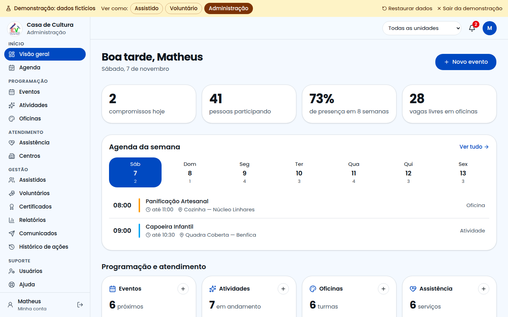
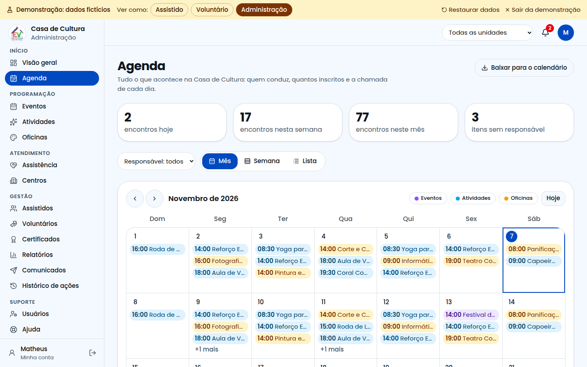
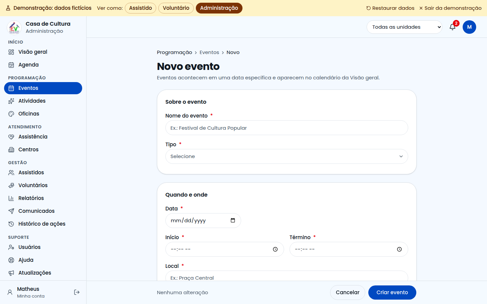
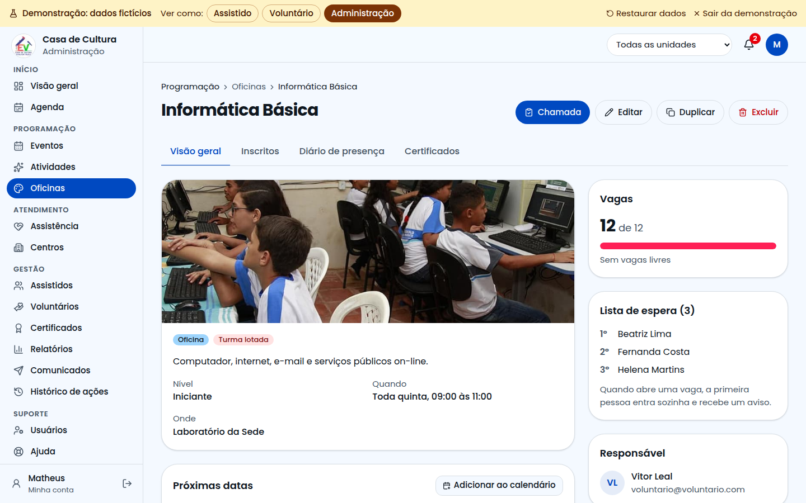
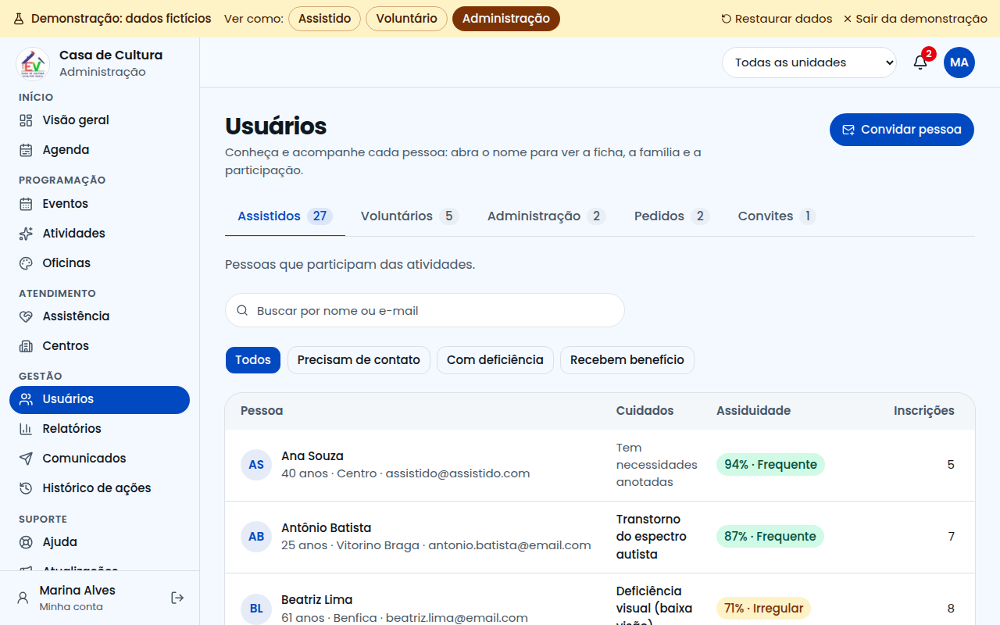
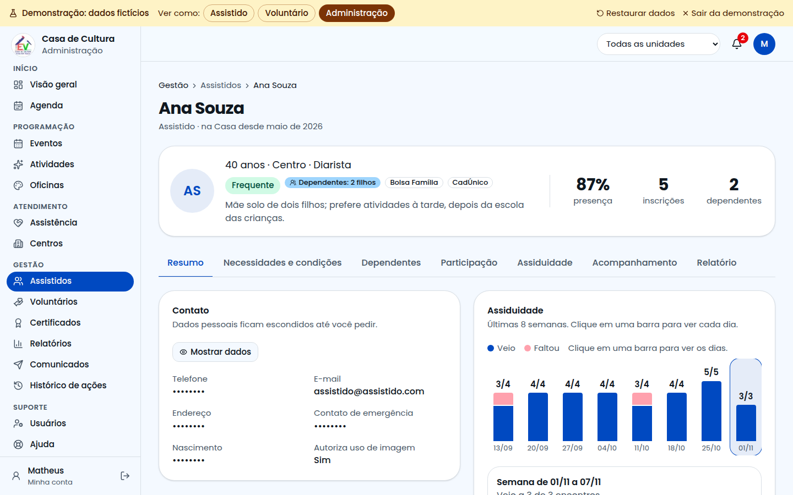
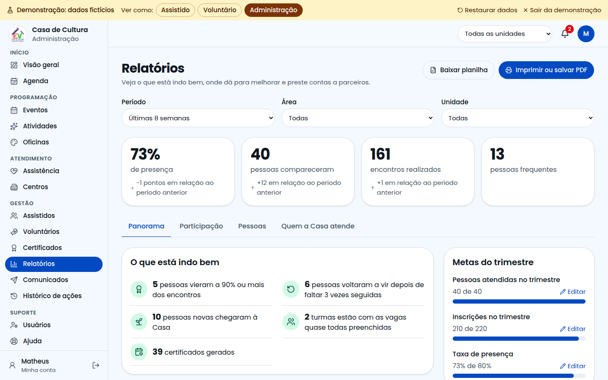

# Guia da Administração

Este guia é para a coordenação e a equipe administrativa. Aqui você cadastra a programação, conhece e acompanha as pessoas, e presta contas dos resultados.

## Como entrar

A entrada da administração **não aparece na página inicial**. Acesse o endereço do sistema com **/administracao** no final e entre com seu e-mail e senha.

## Visão geral

É a tela do dia a dia, nesta ordem:

1. os números principais;
2. a agenda da semana;
3. o quadro com eventos, atividades, oficinas e assistência;
4. **Precisa de atenção**, com pendências como pessoas que faltaram muito, pedidos sem resposta e itens sem responsável.

## Agenda

Mostra tudo o que acontece, em três formatos: **Mês**, **Semana** e **Lista**. O botão **Baixar para o calendário** gera um arquivo para o celular.

## Qual cadastro usar

| Use | Quando | Exemplo |
|---|---|---|
| **Evento** | Acontece em uma data | Festival de Cultura Popular |
| **Atividade** | Se repete, ou acontece uma vez | Aula de Violão |
| **Oficina** | Turma com vagas limitadas | Pintura em Tela |
| **Assistência** | Serviço de apoio | Orientação Jurídica |
| **Centro** | Local onde o projeto atua | Núcleo Benfica |

## Como cadastrar

1. No menu, escolha o tipo.
2. Clique em **Novo** (ou **Nova**).
3. Preencha os campos com asterisco. **A foto é obrigatória**: ela aparece para quem vai se inscrever.
4. Clique em **Criar**.

Se faltar algo, o campo fica vermelho e explica o que fazer.

## A página de cada item

Ao clicar em um item, você vê a foto, as próximas datas, as vagas, a lista de espera, o responsável e um **mapa com o endereço**.

Nessa página você pode abrir a **Chamada**, **Editar**, **Duplicar** (bom para repetir no próximo semestre) e **Excluir**.

## Usuários: conhecer e cuidar de cada pessoa

As pessoas estão separadas em **Assistidos**, **Voluntários** e **Administração**, além das abas **Pedidos** e **Convites**. Em Assistidos, filtre por quem **precisa de contato**, **tem deficiência** ou **recebe benefício**.

Clique no nome para abrir a página da pessoa:

| Aba | O que tem |
|---|---|
| Resumo | Contato, assiduidade, último acompanhamento e família |
| Necessidades e condições | Deficiência, o que ajuda essa pessoa, saúde e condição social |
| Família | Parentes e ligação com a ficha de outros assistidos |
| Participação | Presença em cada atividade e últimos encontros |
| Acompanhamento | Visitas, ligações, encaminhamentos e próximos passos |

Se a pessoa faltou 3 vezes seguidas, um aviso sugere entrar em contato.

> **Cuidado:** essas informações são sensíveis. Registre só o necessário, com o consentimento da pessoa ou do responsável. Os dados pessoais ficam escondidos até você clicar em **Mostrar dados**.

Na página de um voluntário, você vê em quais dias ele pode ajudar, de que forma e quais são seus compromissos.

## Relatórios

Escolha o período, a área e a unidade. Os números mostram a diferença em relação ao período anterior.

| Aba | O que mostra |
|---|---|
| Panorama | Presença mês a mês, destaques e metas |
| Participação | Tabela com cada item |
| Pessoas | Quem precisa de contato e o perfil do público |

Depois, baixe a planilha ou salve em PDF para enviar a parceiros.

## Comunicados e histórico

- **Comunicados:** envie avisos a assistidos, voluntários ou inscritos em um item.
- **Histórico de ações:** veja quem criou, alterou ou excluiu cada informação.

## Filtrar por unidade

No alto da tela, escolha uma unidade em **Todas as unidades**. As listas, a agenda e os relatórios passam a mostrar só aquela unidade.

## Sua conta

Clique no círculo com suas iniciais. Lá você muda a aparência e a senha, e ativa a **verificação em duas etapas**, recomendada para administradores.

## Precisa de ajuda?

Abra **Ajuda** ou confira **Status do sistema**. Se o problema continuar, clique em **Falar com o Suporte Técnico**.
