# Guia da Administração

**Para quem é:** coordenação e equipe administrativa.
**O que você faz aqui:** cadastrar a programação (eventos, atividades, oficinas), os locais (centros) e serviços (assistência), definir quem é voluntário, acompanhar presenças e a situação geral da Casa de Cultura.

---

## 1. Entrar

Na tela inicial, escolha **Administração** e entre com e-mail e senha.

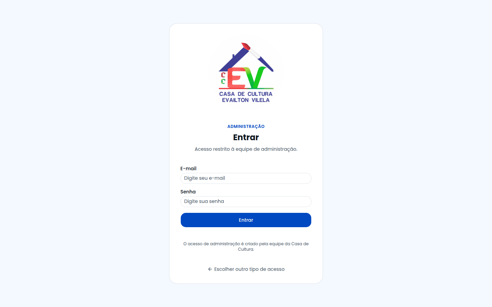

---

## 2. Visão geral (a tela inicial)

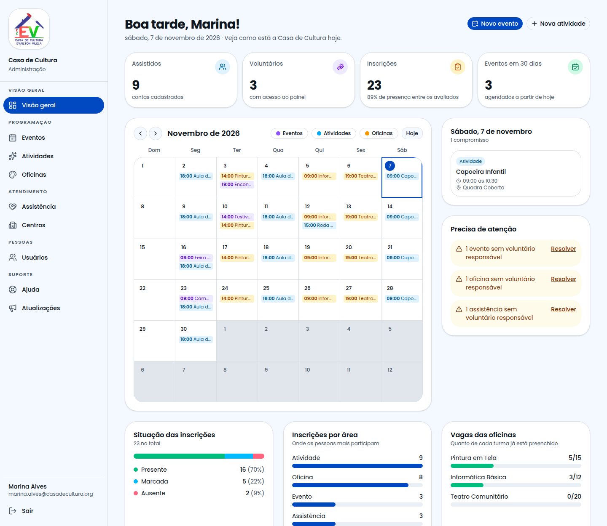

| Bloco | O que mostra |
|---|---|
| **Indicadores** | Assistidos, voluntários, inscrições (com % de presença) e eventos dos próximos 30 dias |
| **Calendário** | Tudo que acontece no mês: eventos, atividades e oficinas. Use as setas para trocar o mês, **Hoje** para voltar e os botões coloridos para **filtrar por tipo** |
| **Agenda do dia** | Ao clicar num dia, mostra horários, locais e atalho para abrir o item |
| **Precisa de atenção** | Pendências: itens sem voluntário responsável, oficinas lotadas, ausência de voluntários |
| **Situação das inscrições** | Presentes, aguardando e ausentes |
| **Inscrições por área** | Onde as pessoas mais participam |
| **Vagas das oficinas** | Quanto de cada turma está preenchido (verde → amarelo → vermelho) |

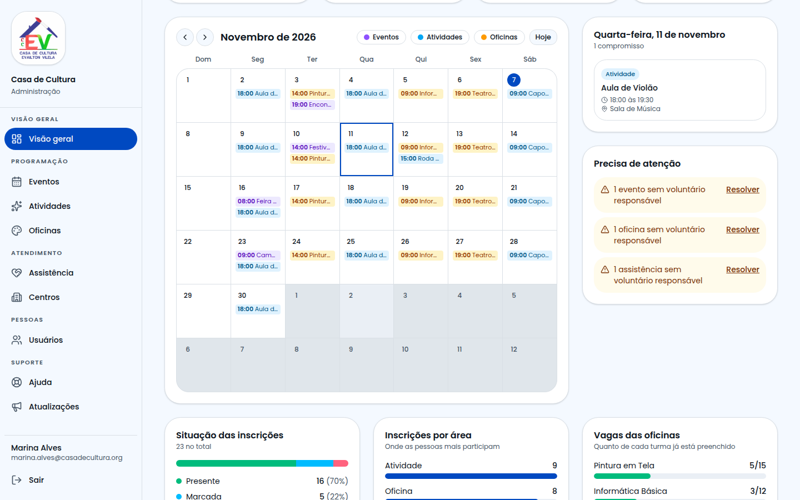

> **No calendário:** eventos aparecem na data; **atividades semanais** e **oficinas** aparecem em todos os dias da semana escolhidos; atividades únicas, na data marcada.

---

## 3. O menu

No computador, o menu fica na esquerda; no celular, no botão ☰ do alto.

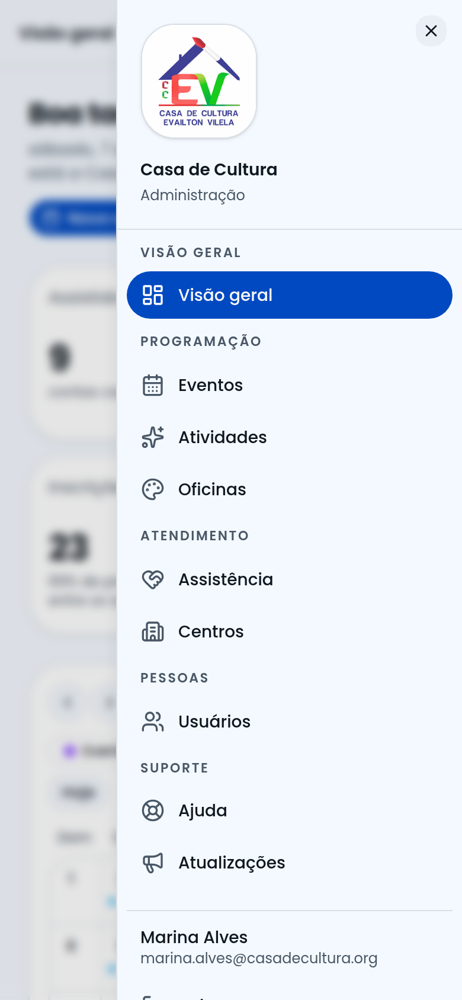

| Grupo | Itens |
|---|---|
| **Visão geral** | Painel com calendário e indicadores |
| **Programação** | Eventos · Atividades · Oficinas |
| **Atendimento** | Assistência · Centros |
| **Pessoas** | Usuários |
| **Suporte** | Ajuda · Atualizações |

---

## 4. Entendendo cada tipo de cadastro

| Tipo | Use quando… | Exemplo |
|---|---|---|
| **Evento** | acontece em **uma data** específica | Festival de Cultura Popular |
| **Atividade** | **se repete** toda semana (ou acontece uma vez) | Aula de Violão, segundas e quartas |
| **Oficina** | é uma **turma com vagas**, num dia fixo da semana | Pintura em Tela, terças 14h |
| **Centro** | é uma **unidade física** | Centro Comunitário Norte |
| **Assistência** | é um **serviço de apoio** | Orientação Jurídica, Cesta Básica |

---

## 5. As listas

Todas as listas funcionam igual:

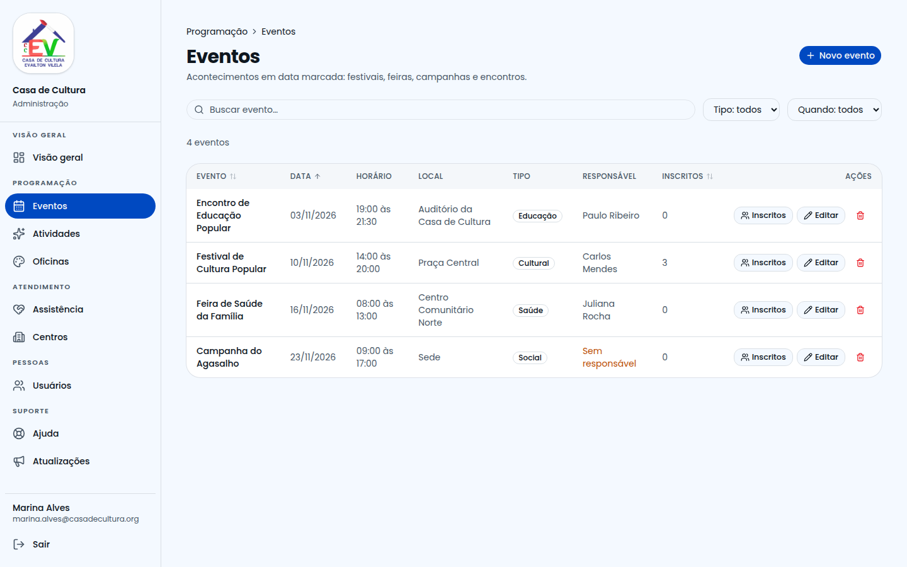

- **Buscar:** digite parte do nome, local ou responsável.
- **Filtrar:** use a caixa ao lado (ex.: tipo, nível).
- **Ordenar:** clique no título da coluna (clique de novo para inverter).
- **Inscritos:** abre a presença daquele item.
- **Editar:** abre o formulário preenchido.
- **🗑 Excluir:** pede confirmação antes.

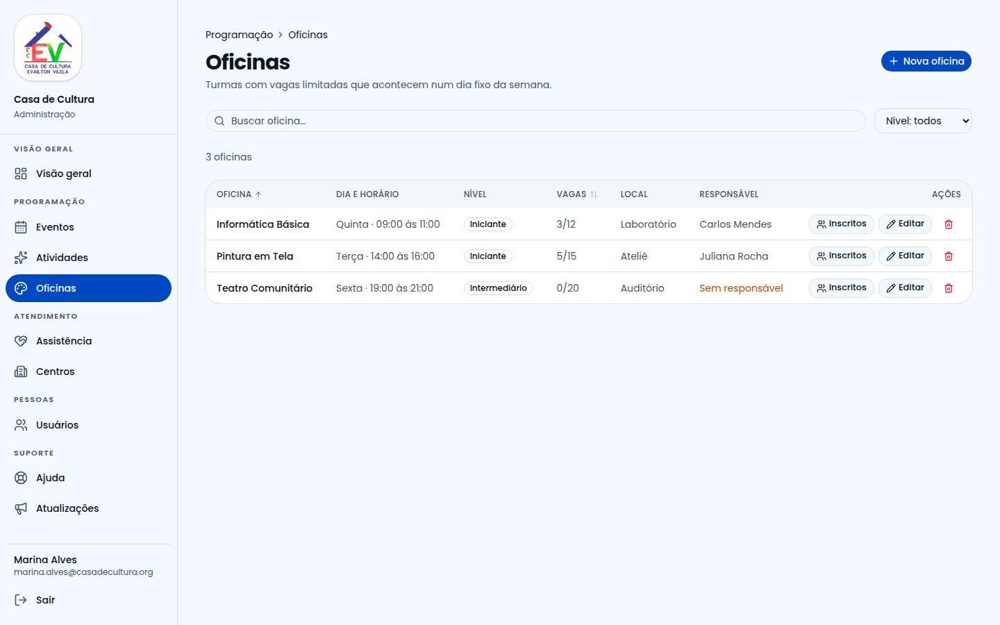

Em **Oficinas**, a coluna **Vagas** mostra *inscritos/vagas* e avisa **"lotada"** em vermelho.

### Excluir com segurança
Ao clicar em excluir, o sistema pergunta se você tem certeza. **A exclusão é definitiva.** Se excluir algo importante por engano, avise o T.I. o quanto antes.

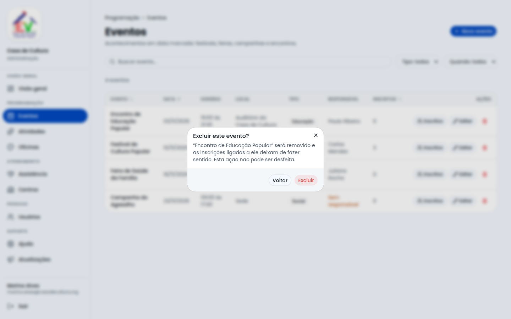

---

## 6. Cadastrar um evento (passo a passo)

1. Menu **Programação → Eventos** → **Novo evento**.
2. Preencha os campos marcados com **\***:
   - **Nome** e **Tipo** (Cultural, Social, Saúde, Educação);
   - **Data**, **Início** e **Término**;
   - **Local**.
3. (Opcional) escolha o **Voluntário responsável**.
4. Clique em **Criar evento**.

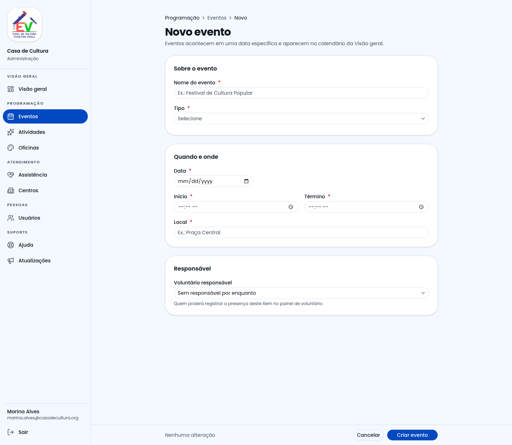

### Se algo estiver errado
Os campos ficam em **vermelho** com a explicação, e a tela leva você ao primeiro problema.

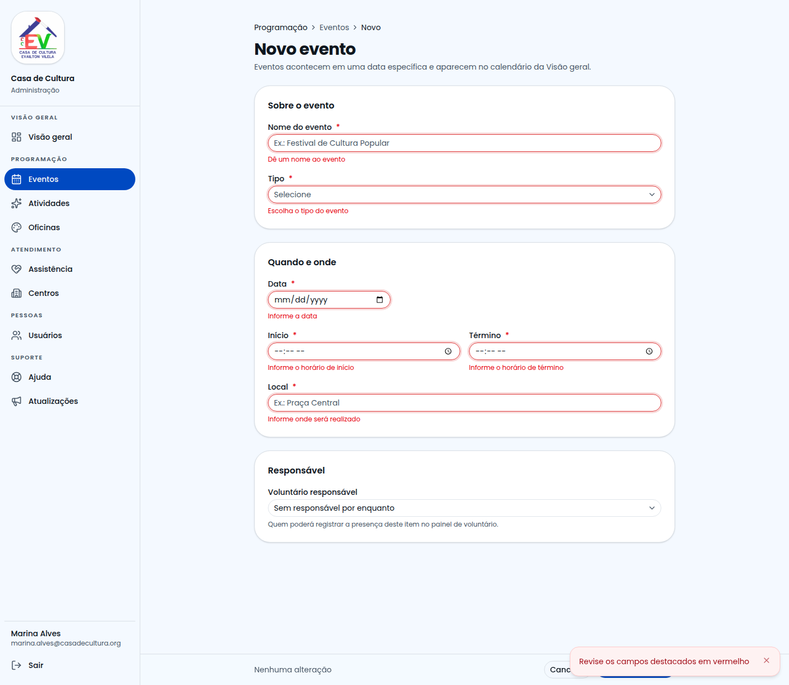

> Se você começar a preencher e tentar **Cancelar**, o sistema avisa que há alterações não salvas.

---

## 7. Cadastrar uma atividade semanal

1. **Programação → Atividades → Nova atividade**.
2. Informe **nome** e **local**.
3. Em **Frequência**, escolha **Toda semana**.
4. Toque nos **dias da semana** (Seg, Ter…). Para cada dia aparece um par de horários.
5. Para repetir o mesmo horário em todos os dias, use **"Usar o horário de … em todos os dias"**.
6. Confira o **Resumo** ("Toda segunda e quarta, 18:00 às 19:30") e clique em **Criar atividade**.

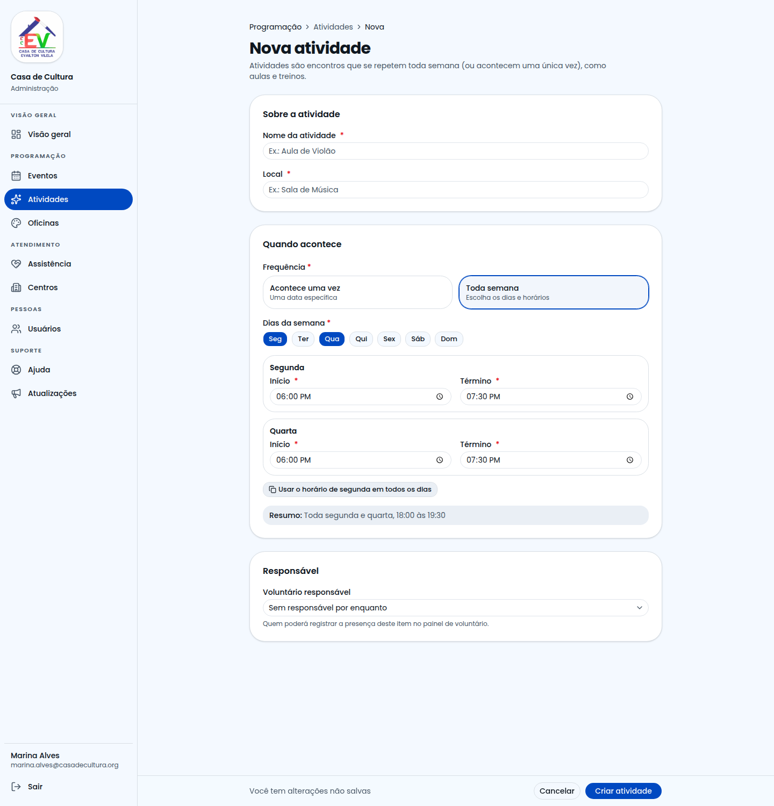

> Para algo que acontece **uma vez só**, escolha **Acontece uma vez** e informe a data.

## 8. Oficinas, centros e assistência
O fluxo é o mesmo: **Novo → preencher → Criar**.
- **Oficina:** além de nome e local, informe **nível**, **vagas**, **dia da semana** e **horários**.
- **Centro:** nome, endereço e telefone (a máscara formata sozinha).
- **Assistência:** nome, **tipo** (Psicológica, Jurídica, Social, Saúde, Alimentar, Educacional) e local.

---

## 9. Usuários e papéis

Em **Pessoas → Usuários** você define o papel de cada pessoa:

| Papel | O que a pessoa vê |
|---|---|
| **Administração** | Este portal completo |
| **Voluntário** | Painel "Meus compromissos" e presença |
| **Assistido** | Painel de inscrições e Explorar |

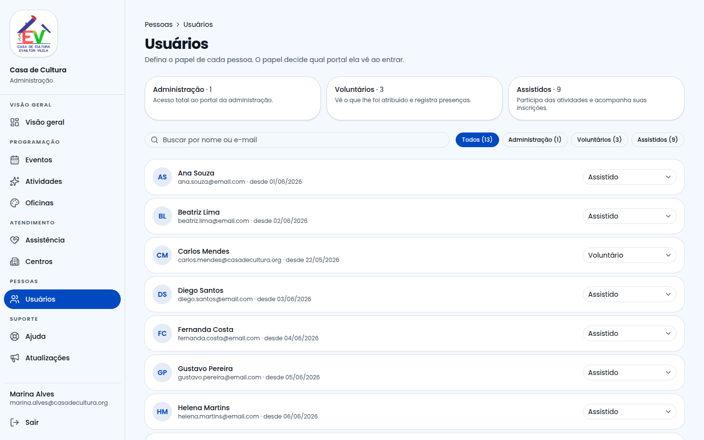

**Como tornar alguém voluntário:**
1. Encontre a pessoa (busca ou filtro).
2. No campo **Papel**, escolha **Voluntário**.
3. Depois, nos cadastros (atividade, oficina…), escolha a pessoa em **Voluntário responsável**.

⚠️ Ao dar ou tirar o papel de **Administração**, o sistema pede confirmação. Você **não pode** alterar o seu próprio papel.

---

## 10. Presença de qualquer item

Na lista, clique em **Inscritos**. Você pode marcar presença, **adicionar** pessoas e **remover** — igual ao voluntário, mas para qualquer item.

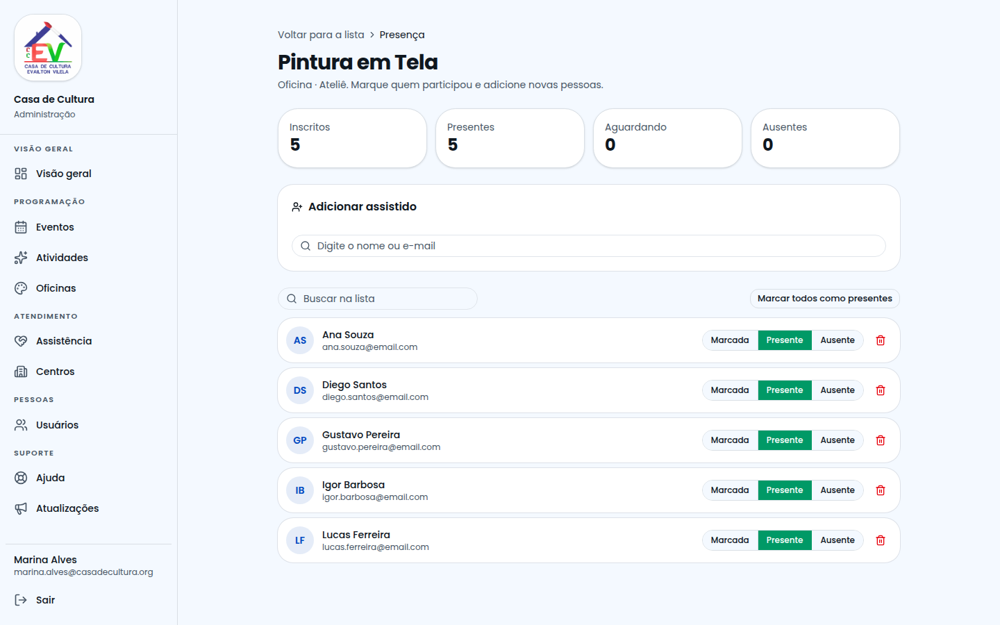

---

## 11. Ajuda, Suporte Técnico e Atualizações

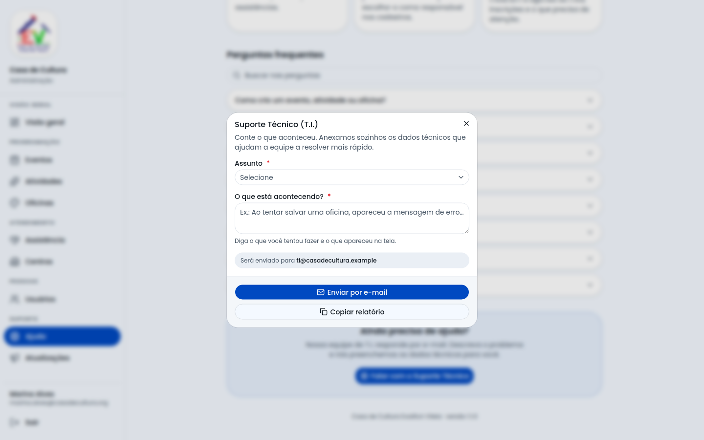

- **Ajuda:** perguntas frequentes e o botão **Falar com o Suporte Técnico** (abre um e-mail pronto para o T.I., com os dados técnicos anexados).
- **Atualizações:** abas **Changelog** (o que mudou) e **Integrações** (o que falta para cada serviço externo).

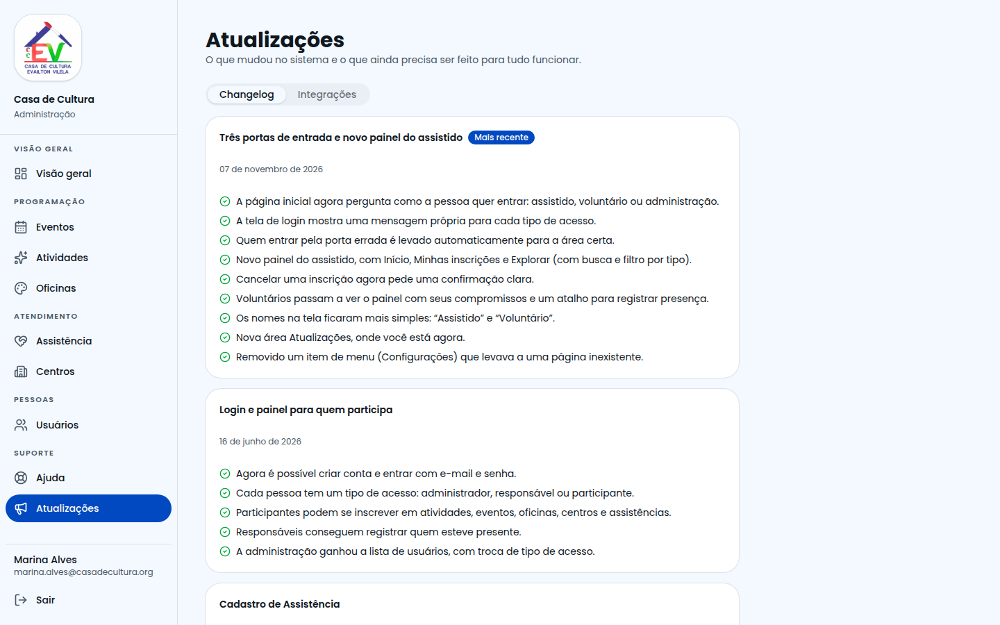

---

## 12. Boas práticas
- Escolha sempre um **voluntário responsável** — sem ele, ninguém registra a presença.
- Revise **"Precisa de atenção"** ao começar o dia.
- Antes de **excluir**, confira se o item não tem inscritos (coluna *Inscritos* / *Vagas*).
- Use nomes claros e padronizados (ex.: "Aula de Violão", não "violao 2").
