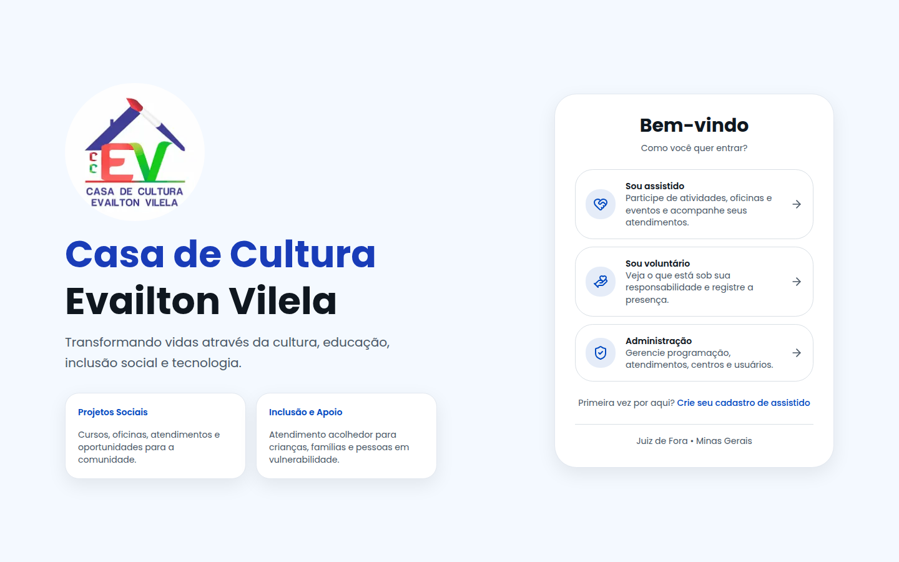
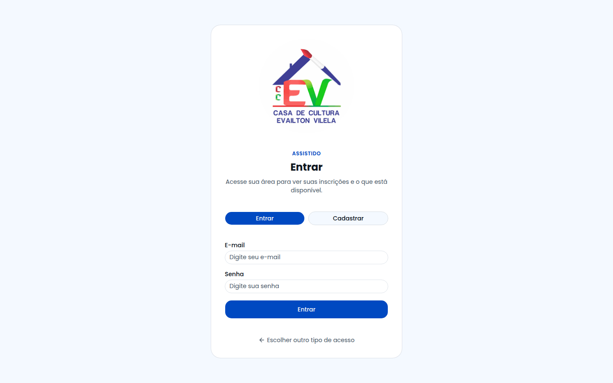
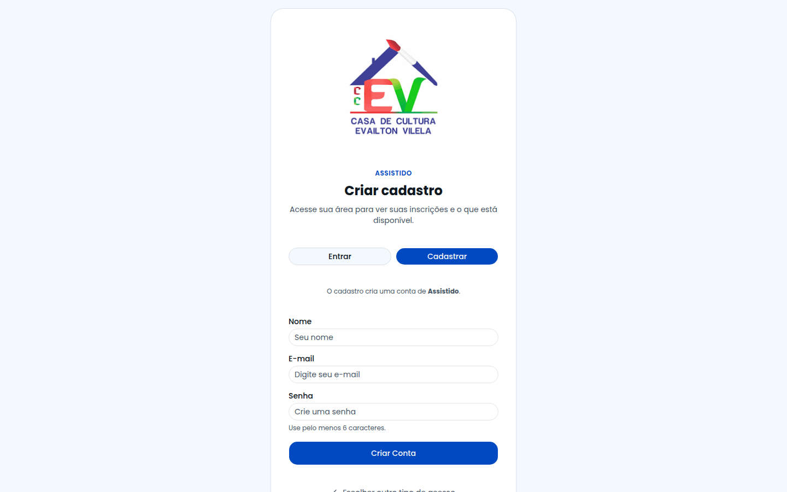
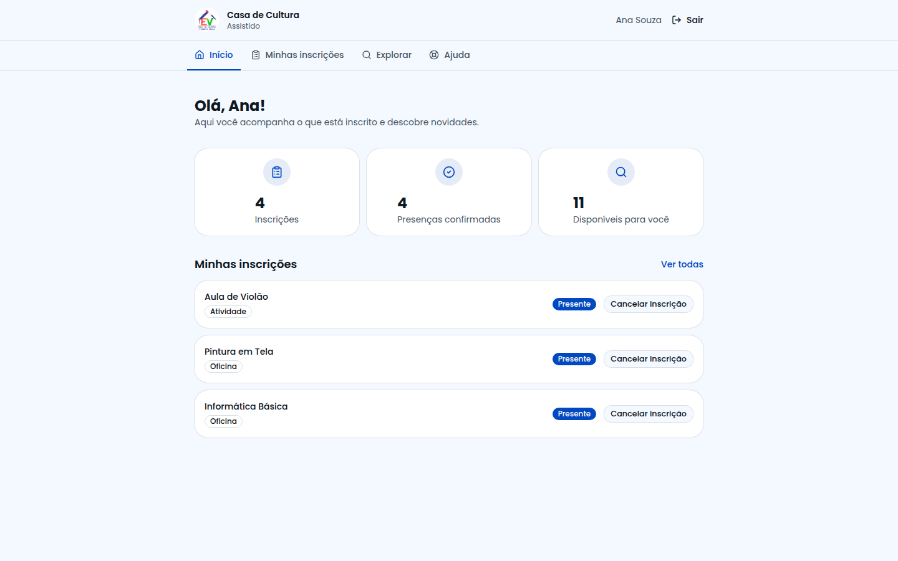
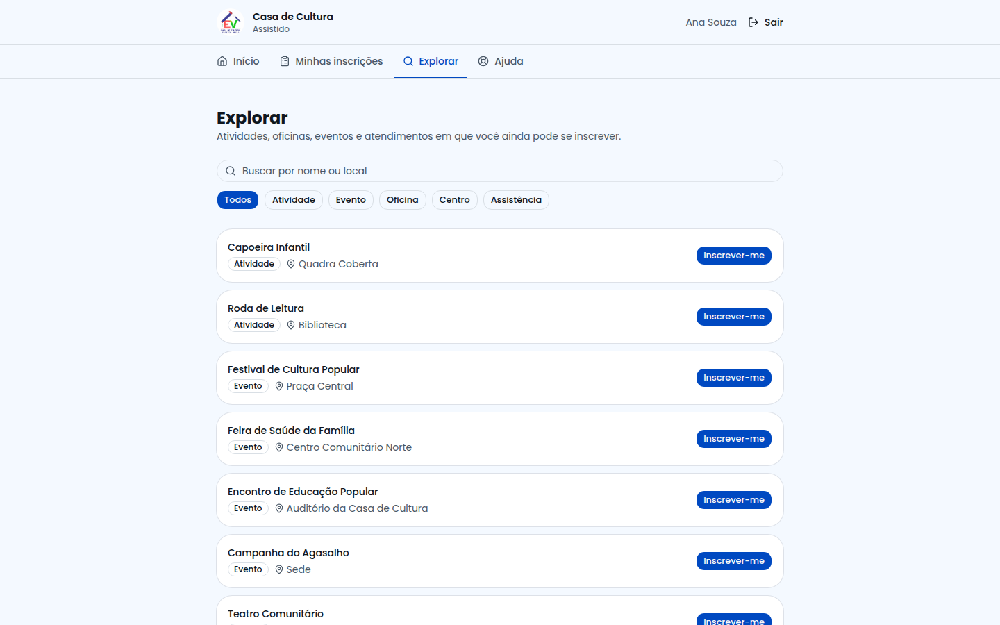
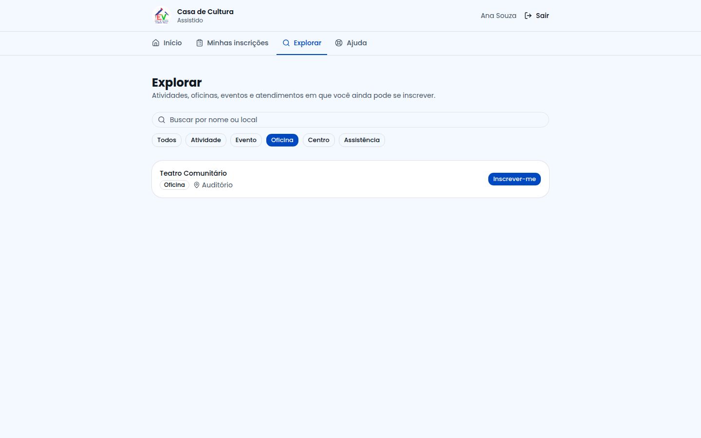
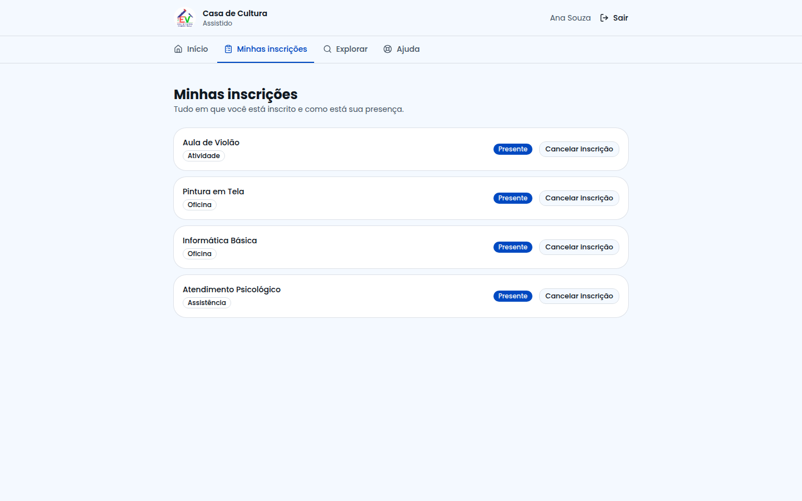
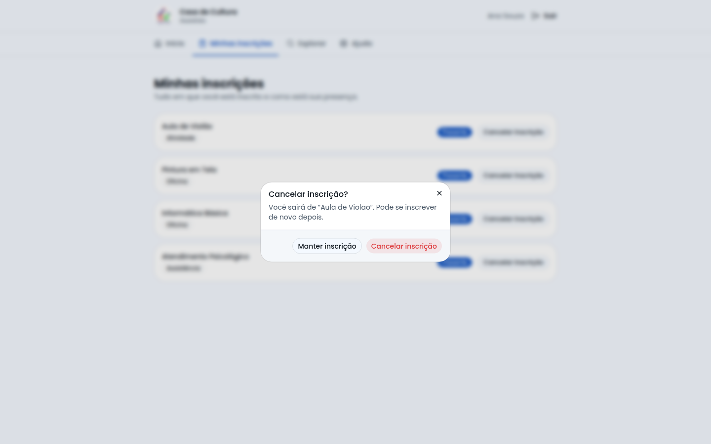
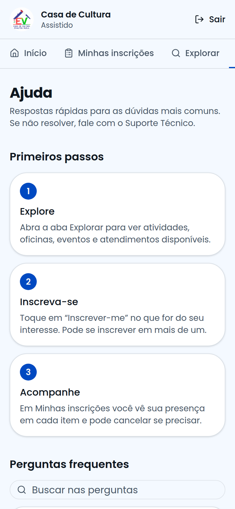

# Guia do Assistido

**Para quem é:** famílias e participantes da Casa de Cultura Evailton Vilela.
**O que você faz aqui:** descobrir atividades, oficinas, eventos e atendimentos, se inscrever e acompanhar sua presença.
Funciona no **celular**, tablet e computador — nada para instalar.

---

## 1. Como entrar

Abra o endereço do sistema. Na tela inicial, escolha **"Sou assistido"**.

### Já tenho cadastro
1. Digite seu **e-mail** e sua **senha**.
2. Toque em **Entrar** (ou aperte Enter).

### Primeira vez aqui? Crie seu cadastro
1. Na tela inicial, toque em **"Crie seu cadastro de assistido"** (ou na aba **Cadastrar**).
2. Preencha **nome, e-mail e uma senha**.
3. Toque em **Criar Conta**. Depois entre com os mesmos dados.

> 💡 Dica: anote seu e-mail e senha em um lugar seguro. Se esquecer, use o botão de **Suporte Técnico** na página Ajuda.

---

## 2. Sua tela inicial

Ao entrar você vê um resumo: quantas **inscrições** você tem, quantas **presenças** foram confirmadas e quantas opções estão **disponíveis** para você.

O menu no alto tem 4 áreas:

| Área | Para que serve |
|---|---|
| **Início** | Resumo e suas inscrições mais recentes |
| **Minhas inscrições** | Tudo em que você está inscrito e sua presença |
| **Explorar** | Descobrir e se inscrever em novidades |
| **Ajuda** | Perguntas frequentes e Suporte Técnico |

---

## 3. Como se inscrever

1. Toque em **Explorar**.
2. Procure o que interessa: digite no campo **Buscar** ou use os botões de tipo (*Atividade, Evento, Oficina, Centro, Assistência*).
3. Toque em **Inscrever-me** no item escolhido.
4. Pronto! Aparece a mensagem **"Inscrição realizada!"** e o item passa para *Minhas inscrições*.

Usando o filtro por tipo (exemplo: só **Oficinas**):

---

## 4. Acompanhar suas inscrições

Em **Minhas inscrições** você vê cada item e a situação:

| Situação | O que significa |
|---|---|
| **Marcada** | Você está inscrito; ainda não houve registro de presença |
| **Presente** | O voluntário confirmou que você participou ✅ |
| **Ausente** | O voluntário registrou que você não compareceu |

## 5. Cancelar uma inscrição

1. Em **Minhas inscrições**, toque em **Cancelar inscrição** no item.
2. O sistema pergunta se tem certeza. Toque em **Cancelar inscrição** para confirmar, ou em **Manter inscrição** para desistir de cancelar.

Você pode se inscrever novamente depois, se quiser.

---

## 6. Precisa de ajuda?

Abra **Ajuda** no menu. Lá estão os primeiros passos, as perguntas mais comuns e o botão **"Falar com o Suporte Técnico"**.

### Como pedir ajuda ao Suporte Técnico
1. Toque em **Falar com o Suporte Técnico**.
2. Escolha o **assunto** e conte **o que está acontecendo**.
3. Toque em **Enviar por e-mail**. Seu aplicativo de e-mail abre com a mensagem pronta (já inclui dados técnicos que ajudam a equipe). Basta **enviar**.

---

## 7. Perguntas rápidas

**Não aparece nada em Explorar.** Pode ser que você já esteja inscrito em tudo ou que a Casa ainda não tenha cadastrado novidades.
**Esqueci minha senha.** Peça ajuda pelo Suporte Técnico informando o e-mail do cadastro.
**Posso me inscrever em mais de uma coisa?** Sim.
**Posso usar no celular?** Sim, foi feito para isso.
