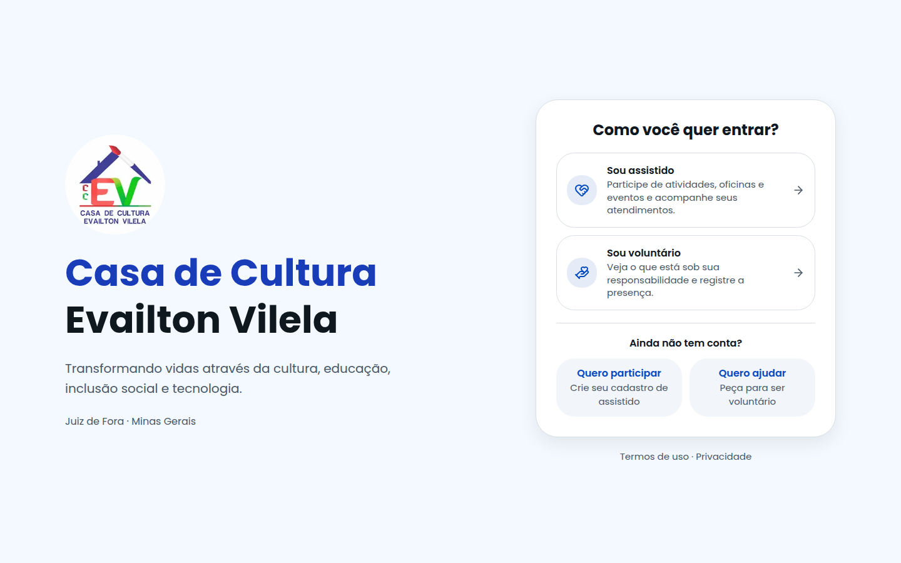
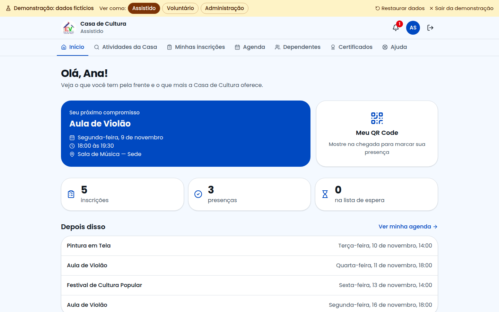
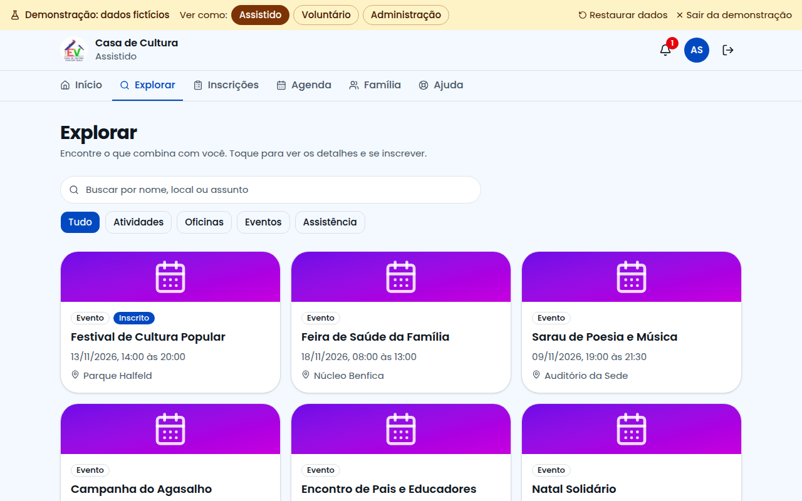
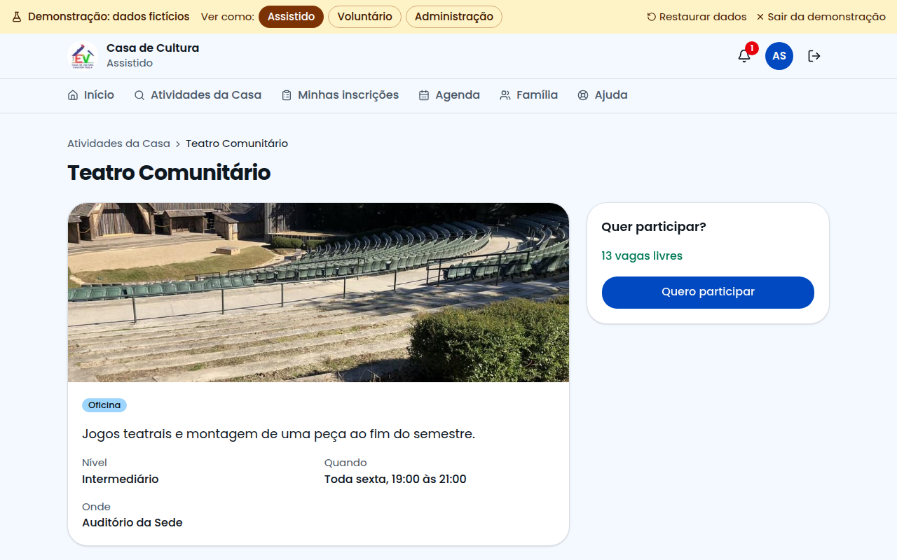
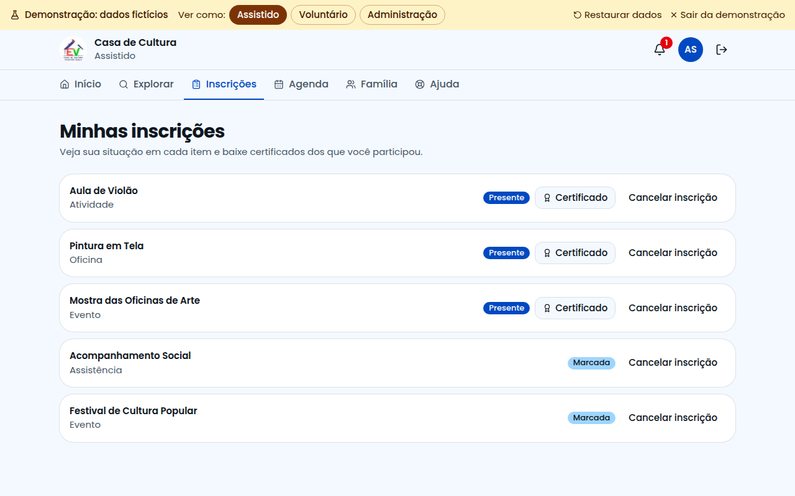
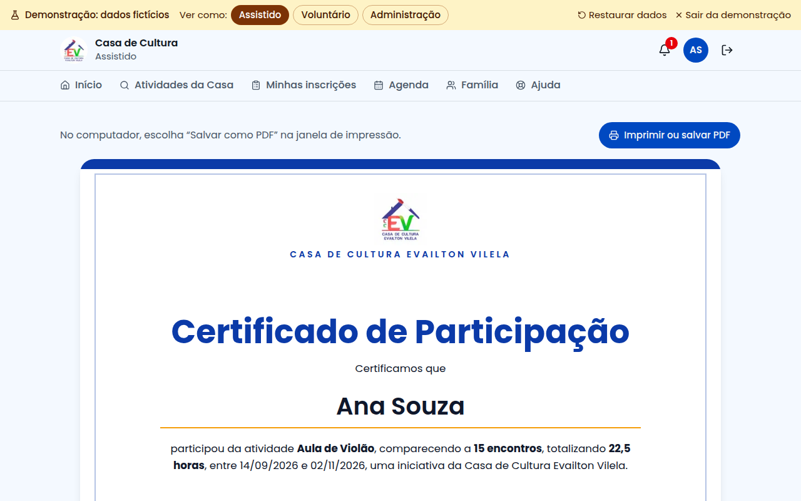
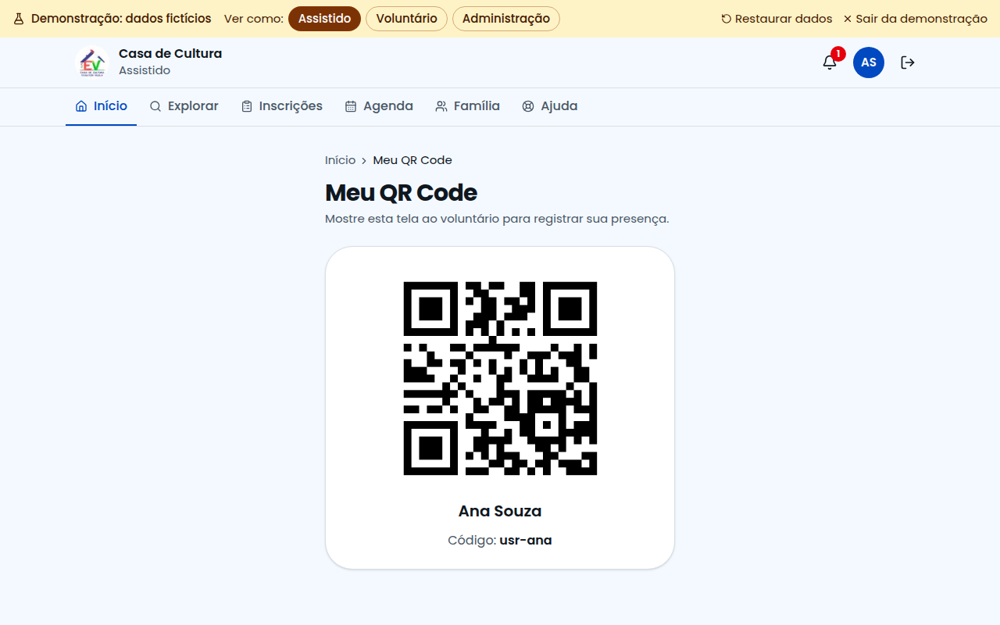

# Guia do Assistido

Este guia é para quem participa das atividades da Casa de Cultura. Com o sistema você vê tudo o que a Casa oferece, se inscreve e acompanha sua participação. Funciona no celular e no computador.

## Como entrar

Na página inicial, clique em **Sou assistido**. Digite seu e-mail e sua senha e clique em **Entrar**.

Primeira vez? Em **Ainda não tem conta?**, clique em **Quero participar**, preencha seus dados e aceite os termos.

Esqueceu a senha? Na tela de entrada, clique em **Esqueci minha senha** e receba um link por e-mail.

## Sua tela inicial

Aqui você vê seu próximo compromisso, seu QR Code, os compromissos seguintes e sugestões do que mais pode fazer.

## Atividades da Casa

Esta tela mostra tudo o que a Casa de Cultura oferece. Use as abas no alto:

| Aba | O que mostra |
|---|---|
| Tudo o que a Casa oferece | Todas as opções |
| Posso me inscrever | O que ainda tem vaga e você não faz |
| Já participo | O que você já faz ou em que está na lista de espera |

Você também pode buscar pelo nome e filtrar por dia da semana e por tipo.

## Como se inscrever

Clique em **Quero participar** no cartão. Se quiser saber mais antes, clique no nome: a página mostra a foto, as próximas datas e um mapa com o endereço.

## Quando a turma está cheia

Clique em **Entrar na lista de espera**. Se abrir uma vaga, você entra sozinho e recebe um aviso no sino.

## Minhas inscrições

Para cada item, você vê a próxima data e quantas vezes compareceu. Para sair de um item, clique em **Cancelar inscrição**.

## Seu certificado

Quando o responsável gerar um certificado para você ou para um dependente, chega um aviso. Abra **Certificados** no menu e clique em **Baixar**. Ele pode valer para uma atividade, um conjunto de atividades ou um encontro. Depois, escolha "Salvar como PDF" na janela de impressão.

## No dia da atividade

Ao chegar, abra **Meu QR Code**, na tela de Início, e mostre ao voluntário. Ele lê o código e sua presença é marcada naquele dia.

## Agenda e dependentes

- **Agenda:** veja só os seus compromissos ou todos da Casa. Dá para enviar ao calendário do celular.
- **Dependentes:** cadastre seus filhos e outros dependentes, conte os cuidados de cada um, inscreva nas atividades e acompanhe a frequência. Na página de uma atividade, também dá para inscrever direto.

## Sua conta

Clique no círculo com suas iniciais, no alto da tela. Lá você pode:

- mudar seus dados e sua senha;
- aumentar as letras ou usar o tema escuro;
- baixar seus dados ou excluir sua conta.

## Precisa de ajuda?

Abra **Ajuda**. Se não encontrar a resposta, clique em **Falar com o Suporte Técnico**.
