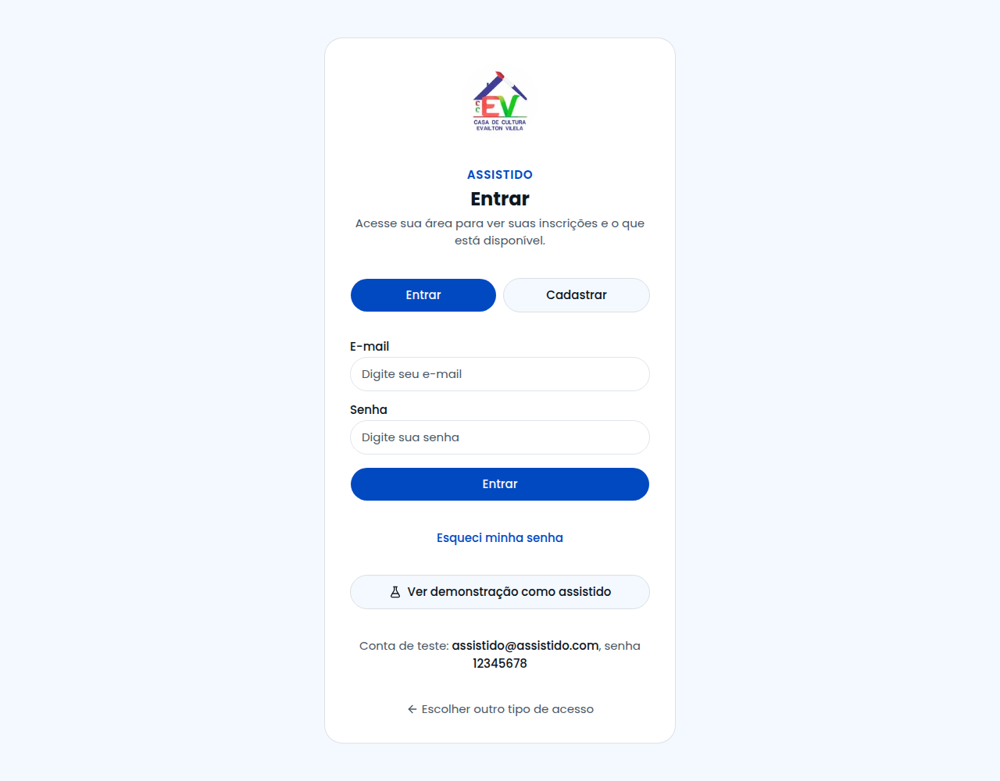
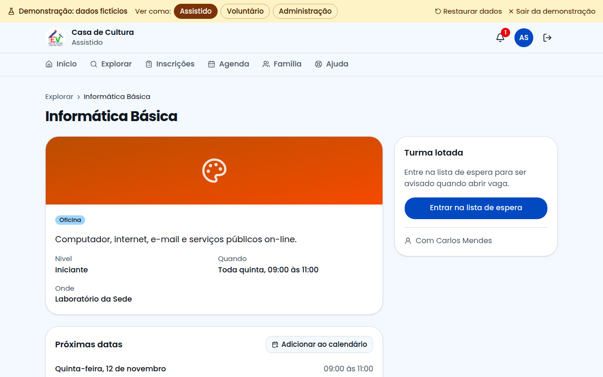

# Guia do Assistido

Este guia é para quem participa das atividades da Casa de Cultura. Com o sistema você encontra o que fazer, se inscreve e acompanha sua participação. Funciona no celular e no computador.

## Como entrar

Na página inicial, clique em **Sou assistido**. Digite seu e-mail e sua senha e clique em **Entrar**.

Primeira vez? Clique em **Crie seu cadastro**, preencha seus dados e aceite os termos.

Esqueceu a senha? Clique em **Esqueci minha senha** e receba um link por e-mail.

## Sua tela inicial

Aqui você vê seu próximo compromisso, seu QR Code e suas inscrições.

## Como se inscrever

1. Abra **Explorar**.
2. Use a busca ou os botões para filtrar por tipo.
3. Clique no que interessar.
4. Clique em **Quero participar**.

## Quando a turma está cheia

Clique em **Entrar na lista de espera**. Se abrir uma vaga, você entra sozinho e recebe um aviso no sino.

## Suas inscrições

Em **Inscrições** você vê sua situação em cada item:

| Situação | O que significa |
|---|---|
| Marcada | Você está inscrito |
| Presente | Sua presença foi confirmada |
| Ausente | Foi registrada uma falta |

Nos itens com presença confirmada, aparece o botão **Certificado**. Para sair de um item, clique em **Cancelar inscrição**.

## No dia da atividade

Na tela de Início, abra **Meu QR Code** e mostre ao voluntário. A presença é registrada na hora.

## Agenda e família

- **Agenda:** mostra seus compromissos e pode ser enviada ao calendário do celular.
- **Família:** cadastre filhos e dependentes e escolha a atividade de cada um.

## Sua conta

Clique no círculo com suas iniciais, no alto da tela. Lá você pode:

- mudar seus dados e sua senha;
- aumentar as letras ou usar o tema escuro;
- baixar seus dados ou excluir sua conta.

## Precisa de ajuda?

Abra **Ajuda**. Se não encontrar a resposta, clique em **Falar com o Suporte Técnico**.
