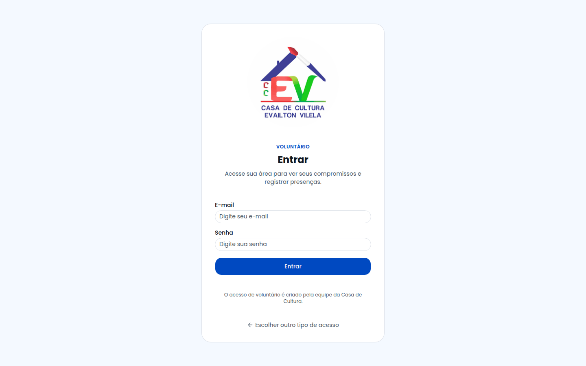
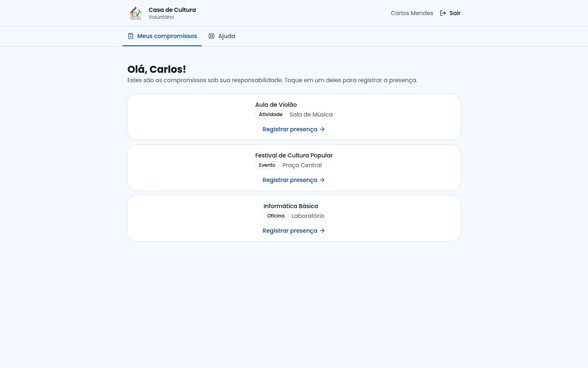
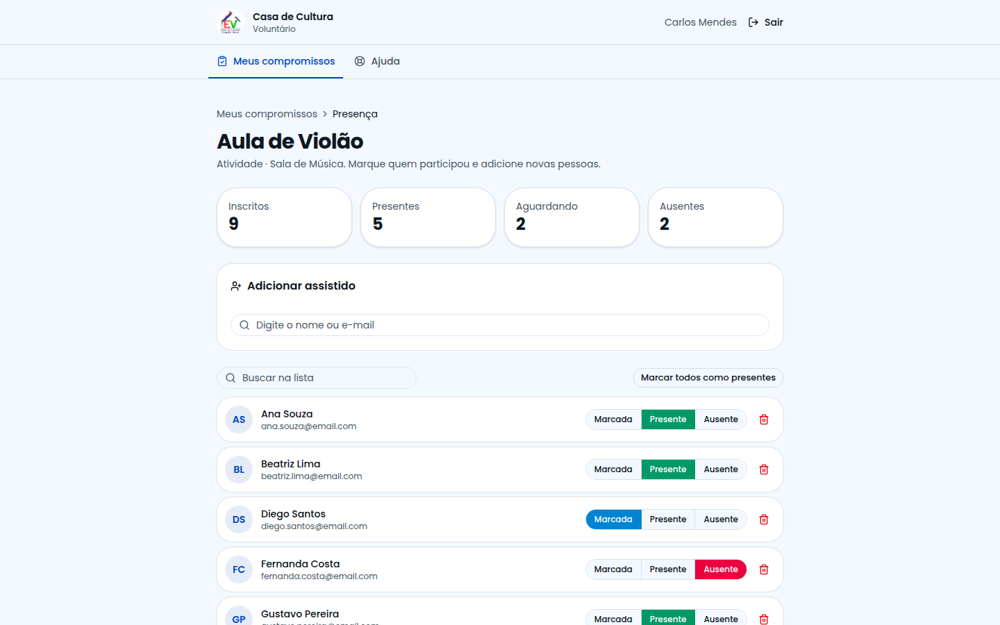
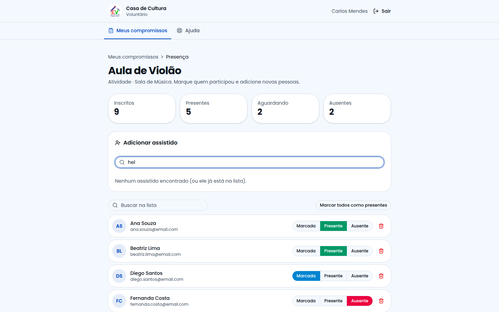
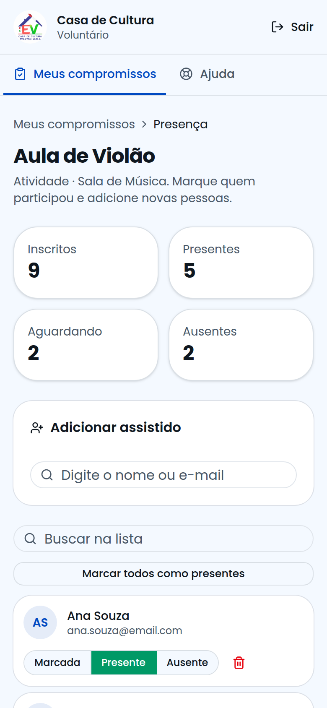

# Guia do Voluntário

**Para quem é:** pessoas que conduzem atividades, oficinas, eventos, centros ou assistências.
**O que você faz aqui:** ver o que está sob sua responsabilidade e **registrar a presença** de cada pessoa — de preferência pelo celular, durante a atividade.

> O acesso de voluntário é criado pela **coordenação**. Se você ainda não consegue entrar, peça que ela mude seu papel para "Voluntário" na área *Usuários*.

---

## 1. Como entrar

Na tela inicial escolha **"Sou voluntário"** e entre com seu e-mail e senha.

> Se você escolher a porta errada, não tem problema: o sistema avisa e leva você para a sua área.

---

## 2. Meus compromissos

A tela inicial lista tudo o que a coordenação atribuiu a você. Cada cartão mostra o **tipo** (Atividade, Oficina…), o **local** e o botão **Registrar presença**.

> Não aparece nada? A coordenação precisa escolher você como **"Voluntário responsável"** no cadastro do item. Use **Ajuda → Suporte Técnico** se precisar.

---

## 3. Registrar a presença

1. Toque no compromisso (ou em **Registrar presença**).
2. No alto você vê os números: **Inscritos, Presentes, Aguardando e Ausentes**.
3. Para cada pessoa, toque em uma das opções:
   - **Presente** — veio;
   - **Ausente** — não veio;
   - **Marcada** — ainda não registrado.
4. A alteração é **salva na hora** (não existe botão "Salvar").

### Atalhos úteis
- **Marcar todos como presentes**: marca a turma inteira; depois corrija só quem faltou.
- **Buscar na lista**: encontre alguém pelo nome ou e-mail.
- Errou? Basta tocar de novo na opção correta.

---

## 4. Alguém veio, mas não estava na lista

1. No cartão **Adicionar assistido**, digite parte do **nome ou e-mail**.
2. Toque em **Adicionar** na pessoa certa.
3. Marque como **Presente**.

> A pessoa precisa ter **conta de assistido**. Se não encontrar, peça que ela se cadastre pela tela inicial ("Crie seu cadastro de assistido").

## 5. Remover alguém da lista
Toque na **lixeira** ao lado do nome e confirme. A pessoa pode ser adicionada de novo depois.

---

## 6. No celular

Tudo foi pensado para telas pequenas: botões grandes, lista rolável e busca no topo.

---

## 7. Perguntas rápidas

**Posso criar uma atividade?** A criação é feita pela coordenação; envie sua sugestão pelo Suporte Técnico.
**Minha internet caiu.** A marcação precisa de internet. (Uso sem internet está no plano de evolução do sistema.)
**Errei uma marcação.** Toque de novo na opção correta; a lista atualiza na hora.
**Quem vê o que eu marco?** A coordenação e o próprio assistido (na tela *Minhas inscrições*).
