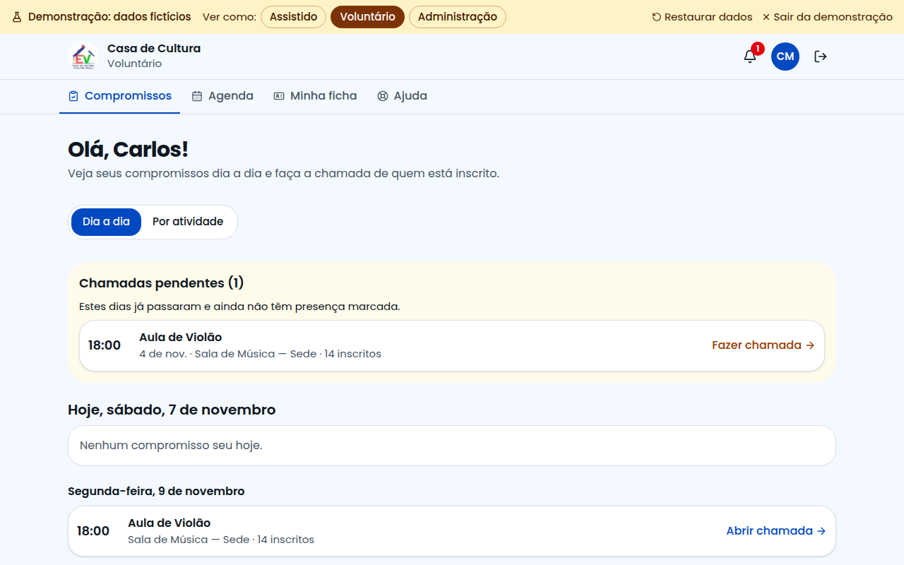
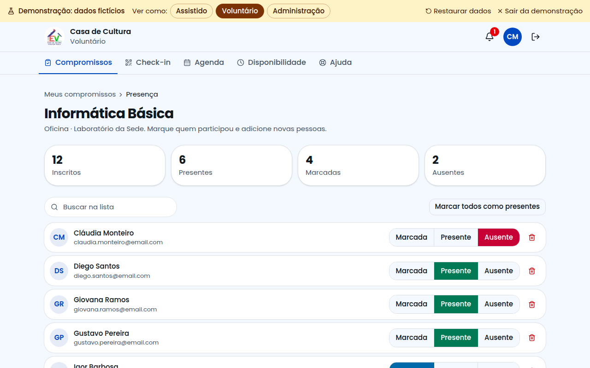
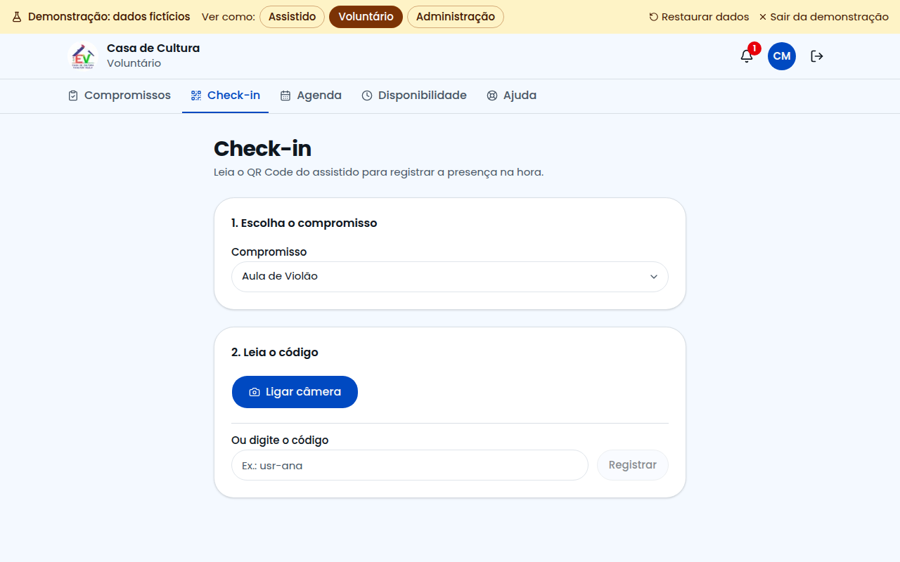
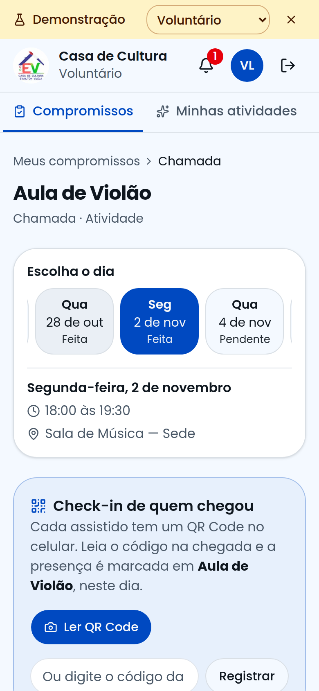

# Guia do Voluntário

Este guia é para quem conduz atividades, oficinas e eventos. Com o sistema você vê seus compromissos e registra quem participou.

## Como entrar

Na página inicial, clique em **Sou voluntário** e entre com seu e-mail e senha.

Ainda não é voluntário? Clique em **Quero ser voluntário** e envie seu pedido. Quem cria o acesso é a coordenação.

## Seus compromissos

A tela inicial mostra o que acontece hoje e tudo o que está sob sua responsabilidade.

Não aparece nada? A coordenação precisa escolher você como responsável pelo item.

## Como registrar a presença

1. Clique no compromisso.
2. Para cada pessoa, clique em **Presente** ou **Ausente**.
3. Pronto. A marcação é salva na hora.

Dicas:

- **Marcar todos como presentes:** depois é só corrigir quem faltou.
- **Errou?** Clique na opção certa.
- **Alguém não está na lista?** Use **Adicionar assistido**, no fim da página.

## Check-in por QR Code

1. Abra **Check-in**.
2. Escolha o compromisso.
3. Clique em **Ligar câmera** e aponte para o código da pessoa.

Se a câmera não funcionar, digite o código que aparece abaixo do QR Code.

## Sem internet

Pode continuar marcando a presença. Um aviso mostra o que ficou guardado, e tudo é enviado quando a conexão voltar.

## No celular

O sistema foi feito para ser usado durante a atividade, no celular. Dá para instalar: no menu do navegador, escolha **Adicionar à tela inicial**.

## Sua disponibilidade

Em **Disponibilidade**, marque os dias e horários em que pode ajudar. A coordenação usa essa informação para organizar a programação.

## Precisa de ajuda?

Abra **Ajuda**. Se não encontrar a resposta, clique em **Falar com o Suporte Técnico**.
