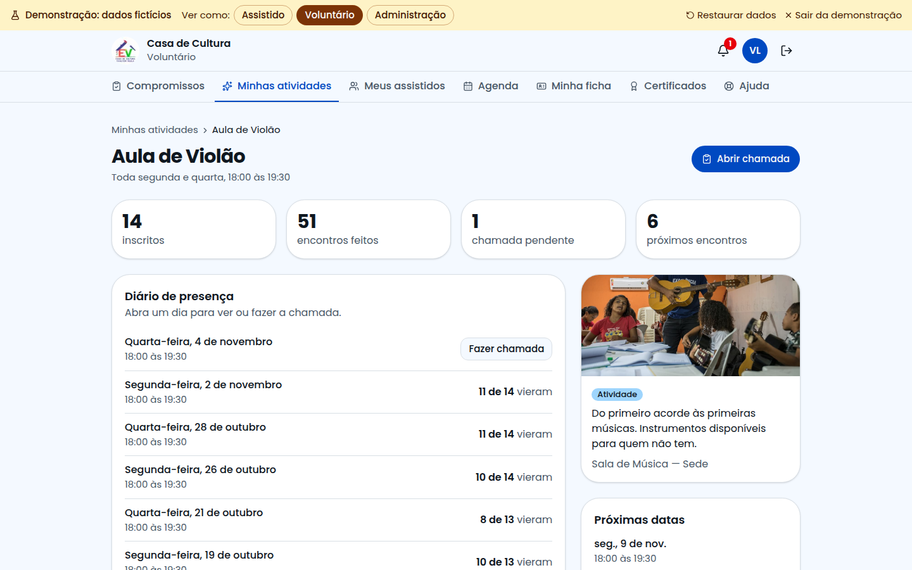
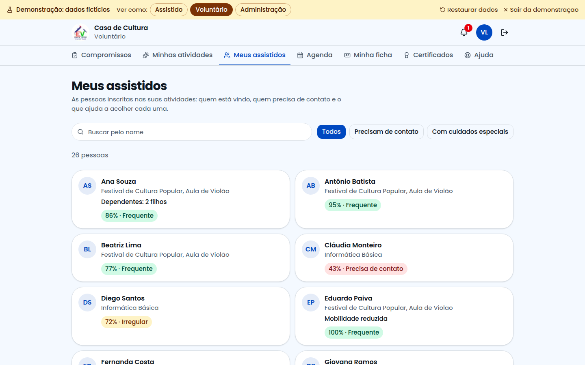
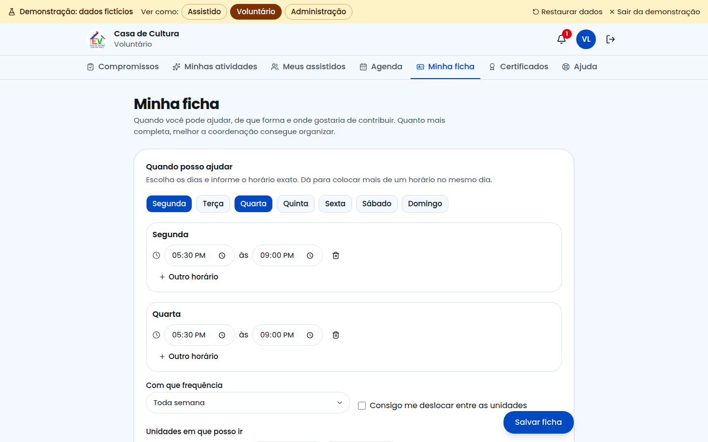

# Guia do Voluntário

Este guia é para quem conduz atividades, oficinas e eventos. Com o sistema você vê seus compromissos dia a dia, faz a chamada, acompanha suas atividades e as pessoas inscritas nelas.

## Como entrar

Na página inicial, clique em **Sou voluntário** e entre com seu e-mail e senha.

Ainda não é voluntário? Em **Ainda não tem conta?**, clique em **Quero ajudar** e preencha o pedido. A coordenação analisa e cria o seu acesso.

## Compromissos dia a dia

A tela inicial mostra só as datas que existem de fato: primeiro as chamadas pendentes, depois hoje e os próximos dias.

Não aparece nada? A coordenação precisa escolher você como responsável pelo item.

## Como fazer a chamada

1. Clique no compromisso.
2. Em **Escolha o dia**, confira a data. Cada dia mostra se a chamada está feita, pendente ou se ainda vai acontecer.
3. Para cada pessoa, clique em **Presente** ou **Ausente**. Salva na hora.

Dicas:

- **Marcar os restantes como presentes:** depois é só corrigir quem faltou.
- **Errou?** Clique na opção certa. Clicar de novo apaga a marcação.
- **Alguém não está na lista?** Use **Adicionar assistido**, no fim da página.

## O que é o check-in

É a forma mais rápida de marcar presença: **cada assistido inscrito tem um QR Code no celular** e mostra na chegada.

Ele fica dentro da chamada, no quadro **Check-in de quem chegou**, e vale para a atividade e o dia que estão abertos.

1. Clique em **Ler QR Code** e aponte a câmera para o código da pessoa.
2. A presença é marcada e o nome aparece na tela.

Se a câmera não funcionar, digite o código que aparece abaixo do QR Code. Se a pessoa não estiver inscrita, o sistema pergunta se você quer inscrevê-la e marcar a presença.

## Certificados

Se a atividade emite certificado, quando ela terminar:

1. Abra a chamada e clique em **Liberar certificados**.
2. Quem tem presença recebe um aviso e pode baixar o seu.

**Você também tem certificado** pelo trabalho que conduziu. Abra **Certificados** e clique em **Baixar meu certificado**. Ele mostra os encontros e as horas.

## Sem internet

Pode continuar marcando a presença. Um aviso mostra o que ficou guardado, e tudo é enviado quando a conexão voltar.

## No celular

O sistema foi feito para ser usado durante a atividade, no celular. Dá para instalar: no menu do navegador, escolha **Adicionar à tela inicial**.

## Agenda

Escolha entre **Só os meus** e **Todos da Casa**, em formato de mês, semana ou lista.

## Minhas atividades

Mostra tudo o que está sob sua responsabilidade. Abra uma atividade para ver:

- o diário de presença: cada dia, com quantos vieram e as chamadas que faltam;
- quem está inscrito, os dependentes e os cuidados de cada pessoa;
- as próximas datas, a lista de espera e o mapa.

## Meus assistidos

Mostra as pessoas inscritas nas suas atividades. Filtre por quem **precisa de contato** ou tem **cuidados especiais**. Ao abrir uma pessoa, você vê a frequência, o que ajuda a acolher e o contato de emergência, e pode escrever uma observação para a coordenação.

Você vê só o necessário para acolher bem. Dados como renda e benefícios ficam com a administração. Trate tudo com discrição.

## Minha ficha

Quanto mais completa, melhor a coordenação consegue organizar:

- **Quando posso ajudar:** os dias e o horário exato;
- **O que a Casa já oferece e eu quero ajudar:** marque as atividades e veja quais combinam com seus horários;
- **Coisas que posso fazer:** escolha entre as sugestões ou escreva outra ideia;
- **Dados profissionais e pessoais:** profissão, formação, habilidades e contatos.

## Precisa de ajuda?

Abra **Ajuda**. Se não encontrar a resposta, clique em **Falar com o Suporte Técnico**.
